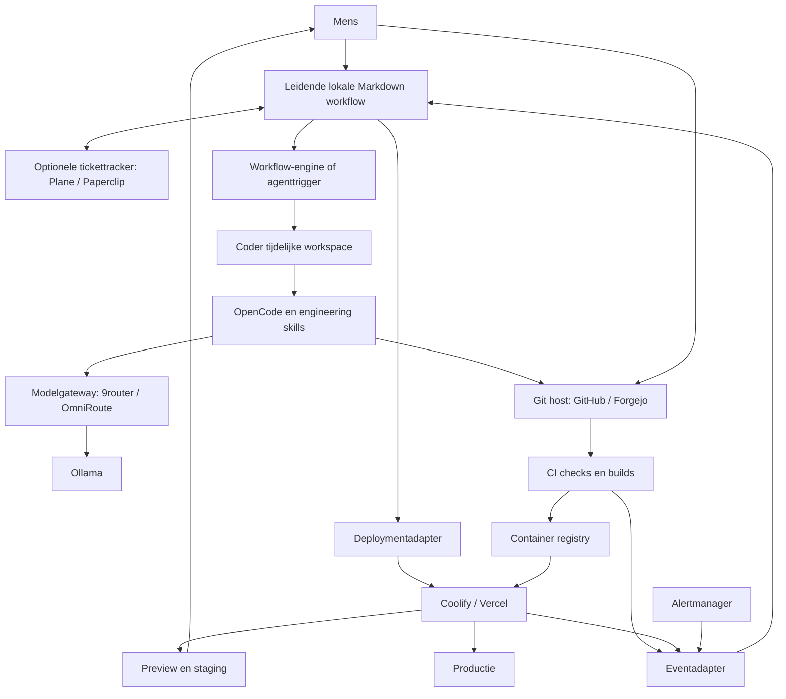

# Software factory projectbeschrijving en bouwplan

Versie 1.2 · 22 november 2026

Status: vastgesteld ontwerp en implementatieplan. Dit bestand bevat de projectkeuzes, architectuur, integratiecontracten, bouwvolgorde en acceptatiecriteria. Het bevat geen reeds geïnstalleerde omgeving of geteste configuratiebestanden. Productversies en API-contracten worden bij de start vastgepind en met de beschreven integratietests gecontroleerd.

## 1 Doel van het project

Bouw een software factory die goedgekeurde Markdown-werkitems omzet in geteste code, pull requests of merge requests, beoordeelbare previews en gecontroleerde deployments. Mensen bepalen scope en accepteren het resultaat. Agents onderzoeken, implementeren en reviewen binnen expliciete grenzen.

De factory wordt tool-agnostisch ontworpen: taken, status, acceptatiecriteria en beslissingen staan in versioneerbare lokale Markdown-bestanden die agents kunnen lezen en wijzigen. Deze bestanden zijn leidend; services zijn vervangbare uitvoerders en interfaces. Een provideradapter kan onder meer Plane als tickettracker, GitHub of Forgejo als git host, Paperclip of Hermes Agent als orchestrator, 9router of OmniRoute als modelgateway en Coolify of Vercel als deploymentprovider aansluiten. Geen van deze producten is vereist om werkitems te definiëren, voortgang te begrijpen of de workflow te hervatten.

Het ontwerp gebruikt uitsluitend de eisen uit dit project. Er worden geen bestaande servers, netwerken, GPU's, domeinen of andere infrastructuuronderdelen verondersteld.

### Gewenst resultaat

Een gebruiker kan een werkitem als lokale Markdown aanmaken of optioneel via een gekoppelde tickettracker bekijken, een voorstel goedkeuren, een preview beoordelen en een verandering integreren. De factory bewaart de relatie tussen werkitem, run, gebruikte skills en modellen, commit, checks, artifact en deployment. Na storingen kan zij uit de Markdown-status en providerreferenties controleren wat al is uitgevoerd voordat zij verdergaat.

### Uitgangspunten

- Zelf gehoste, gratis beschikbare software vormt de basis. Hardware, stroom, beheer en eventuele externe modelkosten vallen daarbuiten.
- Lokale Markdown-bestanden zijn de gezaghebbende specificatie- en workflowbron. Een tickettracker is optioneel en is een projectie/interface, nooit de enige opslag van status of beslissingen.
- Elke servicecategorie heeft een stabiel intern contract en verwisselbare providers. Een providerwissel vereist configuratiewijziging en migratie van providerreferenties, niet herschrijven van taken of projectbeleid.
- De eerste providerkeuzes zijn configureerbaar; voorbeelden in dit plan zijn geen architectuurvereisten.
- Coder Community levert workspaces; OpenCode voert de agentloop uit.
- 9router betekent in dit project `decolua/9router`; OmniRoute is een mogelijke vervanger achter hetzelfde modelgatewaycontract.
- Ollama is de standaard modelservice. Externe providers staan aanvankelijk uit.
- Coolify of Vercel kan de deploymentrol invullen; per applicatie/omgeving is er één actieve deploymentprovider.
- GitHub, Forgejo of een andere compatibele git host kan worden gekozen. Er is op elk moment één gezaghebbende git host per repository.
- Eén actieve coding-run tegelijk is het beginpunt, geen definitieve schaalgrens.

### Buiten de eerste versie

Volledig autonome merges, onbeperkte agentteams, meerdere productieclusters, Kubernetes, een eigen ticketapp, een eigen modeltrainer, automatische externe modelfallback en volledig autonoom herstel van databasewijzigingen vallen buiten de eerste versie. Een centrale service die eigenaar is van de workflowstatus valt eveneens buiten het ontwerp: de Markdown-werkitems zijn voldoende om de workflow te besturen.

## 2 Begrippen en ontwerpdiscipline

Het ontwerpkader is Matt Pococks [software-factory-skill op commit abeeaf9](https://github.com/mattpocock/skills/blob/abeeaf95660ba9e8b7c753eb38f441ca707a8823/skills/in-progress/software-factory/SKILL.md).

| Begrip | Betekenis in dit project |
| --- | --- |
| Task | Een herhaalbaar soort werk, zoals Explore, Implement of Review. |
| Trigger | Een gebeurtenis die een run start. |
| Run | Eén uitvoering van een task, met begin, resultaat en einde. |
| Runner | De tijdelijke uitvoeromgeving van een run. |
| Ticket tracker | De plek voor werk, discussie en menselijke besluiten. |
| Ticket source | Een mens of systeem dat werk aanlevert. |
| Git host | De plek voor code, branches, PR's en reviews. |
| Orchestrator | De service die runs toewijst, start en volgt. |
| Observability platform | De plek waar mensen runstatus, logs en metingen onderzoeken. |

Een run wacht niet op een menselijke reactie. De run schrijft vragen en resultaat naar het werkitem en eindigt; een later besluit start een nieuwe run. De duurzame context en gewenste status staan in lokale Markdown-bestanden in de factory- of projectrepository. Git, tickettracker en orchestrator bewaren hoogstens mirrors, providerobjecten en uitvoeringsmetadata. Checks, afzonderlijke agentreview en menselijke review vormen drie zelfstandige kwaliteitsstappen.

Een tracker kan een individueel ticket ook “task” noemen. In dit document is een task het soort werk; een werkitem is een concreet Markdown-bestand met optionele externe ticketkoppeling.

Een werkitem krijgt een persistent UUID. De categorie (`incident`, `issue` of `planbaar-werk`) en de unieke prioriteit zijn wijzigbaar en vormen geen identiteit. Incidenten zijn actuele storingen of ernstige degradaties; issues zijn gemelde bugs of verzoeken zonder directe storing; planbaar werk omvat goedgekeurde bouw- en onderhoudstaken. Prioriteitsbanden zijn respectievelijk 0–100, 101–200 en vanaf 201. Lagere waarden worden eerder uitgevoerd; tussenwaarden en herschikking zijn toegestaan. De prioriteit moet bij de categorie passen. Een waarde komt opnieuw beschikbaar bij afronding of prioriteitswijziging.

De queue is globaal serieel: maximaal één werkitem is in uitvoering. Een geblokkeerd werkitem bezet de actieve plek niet. De CLI kiest het laagst geprioriteerde uitvoerbare werkitem in `ready/`; alle afhankelijkheden moeten `done` zijn. Bij geen uitvoerbaar werkitem stopt de CLI met uitleg. In fase 1 stelt een mens prioriteiten in. Een latere product-owner-agent kan alle inhoudelijke werkitemvelden aanpassen; scopewijzigingen vereisen menselijke hergoedkeuring, statusovergangen blijven gevalideerd en menselijke acceptatie blijft een menselijke beslissing.

### Tool-agnostische workflow en leidende Markdown

De workflow wordt door agents bestuurd vanuit gewone Markdown en kleine, providerneutrale configuratiebestanden. Voor elk werkitem bestaat één canoniek bestand met persistent UUID, titel, doel, categorie, prioriteit, status, eigenaar, afhankelijkheden, acceptatiecriteria, risicogrens, beslissingen, providerreferenties en runhistorie. Statusovergangen zijn expliciet en gecontroleerd; agents schrijven wijzigingen atomair en behouden auditgeschiedenis. Een optionele tracker zoals Plane toont en bewerkt een gesynchroniseerde projectie.

```text
factory/
  WORKFLOW.md                 # algemene states, overgangen, gates en menselijk akkoord
  providers.yaml              # actieve provider per servicecontract
  tasks/                      # taakdefinities: explore, spec, implement, review, release...
  work-items/
    ready/ <uuid>.md
    in-progress/
    blocked/
    done/
  decisions/                  # ADR's en goedgekeurde scopewijzigingen
  runs/                       # append-only runverslagen en artifactverwijzingen
  schemas/                    # frontmattervelden en statusvalidatie
```

Mappen weerspiegelen status voor leesbaarheid; frontmatter is de machineleesbare statusbron. Verplaatsen en metadata bijwerken gebeurt als één gecontroleerde mutatie. De lokale TypeScript-CLI beheert de queue, validator, globale claim/lease en runlog. Een lease verloopt niet tot heruitvoering zonder verificatie van de runstatus: een veilige hervatting gebruikt dezelfde run; anders wordt die run als onderbroken vastgelegd en start een nieuwe run. Provider-ID's zijn aanvullende verwijzingen, geen primaire identiteit. Providerwebhooks worden genormaliseerd naar interne events en kunnen uitsluitend een run voorstellen; workflowregels en gates in Markdown bepalen of deze wordt uitgevoerd.

De bestanden blijven bruikbaar zonder Plane, Paperclip, GitHub, Forgejo, een hosted orchestrator of netwerkverbinding. Een checkout synchroniseren of committen is optioneel voor agents, maar wijzigingen aan de canonieke bestanden moeten duurzaam worden bewaard; de eerste installatie kan hiervoor een lokale Git-repository gebruiken. Providers leveren triggers, uitvoering, samenwerking en hosting, maar mogen geen eigen niet-gereconcilieerde statusmachine afdwingen. Elk providercontract heeft een capabilitybeschrijving, configuratie, adapter, conformance tests, migratieprocedure en herstelpad. Providerwissels gebeuren per service-slot met één actieve writer en een expliciete cutover.

## 3 Vastgelegde architectuur

| Onderdeel | Startfase | Eindbeeld | Verantwoordelijkheid |
| --- | --- | --- | --- |
| Ticket tracker | Lokale Markdown (Plane optioneel) | Plane of andere provider | Optionele menselijke interface; canonieke werkitems blijven Markdown. |
| Orchestrator | Lokale workflow-engine/agents (Paperclip/Hermes optioneel) | Paperclip, Hermes Agent of andere provider | Triggers en uitvoering; werkstatus en beleidsregels blijven Markdown. |
| Agentomgeving | Coder Community met Docker-workspaces | Ongewijzigd | Omgeving aanmaken, toegankelijk maken en verwijderen. |
| Coding agent | OpenCode | OpenCode | Code onderzoeken, wijzigen en beoordelen. |
| Modelgateway | 9router of OmniRoute | Configureerbare provider | Modelprofielen, routering en gebruiksinzicht via intern contract. |
| Modeluitvoering | Ollama | Ollama | Lokale inferentie. |
| Git host | GitHub SaaS of Forgejo | Configureerbare provider | Git, PR's, reviews en commitstatussen. |
| CI | Provider-agnostische checkcommands met GitHub/Forgejo CI | Configureerbare CI | Deterministische tests en builds. |
| CI-runners | Gekozen hosted of self-hosted runner | Tijdelijke runnercontainers op Proxmox | CI-code uitvoeren. |
| Registry | Provider van keuze | Provider van keuze | OCI-images bewaren. |
| Deployment | Coolify of Vercel | Configureerbare provider | Preview, staging, productie en herstel via deploymentcontract. |
| Monitoring | Prometheus en Alertmanager | Ongewijzigd | Operationele metingen en incidentmeldingen. |
| Logging | Runner/orchestrator logs plus Grafana, Loki en Alloy | Configureerbaar | Activiteit, uitvoerlogs en diagnose. |
| Duurzame opslag | PostgreSQL en productvolumes | Ongewijzigd | Servicegegevens, integratiestatus en artifacts. |

### Samenwerking tussen onderdelen



De pijlen beschrijven de logische samenwerking. Bestaande producten leveren niet automatisch alle koppelingen. De adapters in dit plan worden als kleine integratielaag gebouwd. Ze mogen geen tweede autonoom planningssysteem worden.

### Eigenaarschap van gegevens en resources

- Lokale Markdown is leidend voor scope, status, werktoewijzing, reviewbeleid, menselijke besluiten en taakdefinities.
- Git host (indien ingericht) is leidend voor code en versiegeschiedenis; lokale bestanden blijven voldoende om werk te specificeren en te hervatten.
- CI is leidend voor de uitkomst van deterministische checks op een specifieke commit.
- De registry is leidend voor de inhoud van gepubliceerde images via digest.
- De ingestelde deploymentprovider is leidend voor deploymentuitvoering; de gewenste release en statuskoppeling staan in Markdown.
- Coder beheert workspaces. Coolify beheert geen Coder-workspaces.
- CI-runnerregistraties horen bij de actuele CI-provider. Coder wordt niet standaard het beheerplatform voor CI-runners.
- De integratiedatabase bewaart tijdelijke koppelingen, idempotentiesleutels en herstelstatus; de canonieke workflowstatus blijft in Markdown.

## 4 Applicaties en hun concrete rol

### Tickettrackers en orkestratie

Plane wordt als optionele tickettrackerprovider opgenomen naast Paperclip en lokale Markdown. De initiële architectuur mag Plane gebruiken voor menselijke planning en overzicht, maar geen enkele workflow mag vereisen dat een Plane/Paperclip ticket bestaat. Plane heeft een officiële API en kan via een adapter worden geïntegreerd; valideer tijdens implementatie welke events, velden, rechten en synchronisatiegaranties beschikbaar zijn. Paperclip is een optionele orchestrator; Hermes Agent is een mogelijke vervanger. Beiden starten runs, maar beslissen niet zelfstandig over canonieke statusovergangen.

De adapter projecteert Markdown-werkitems naar gekozen tracker en terug, met veldmapping, conflictregels, idempotentie en periodieke reconciliatie. Lokale claims/leases voorkomen dubbel werk en vervangen productgebonden ticketcheckout. Gebruik eventgestuurde toewijzing en expliciete routines waar de provider dat ondersteunt; anders kan een lokale watcher/CLI of timer de Markdown-queue verwerken. Timer-heartbeats blijven uit tenzij nodig. Reviewlimieten en menselijke goedkeuring staan in `WORKFLOW.md`, niet als alleen-in-Paperclip-beleid.

Menselijke goedkeuring in Markdown is een workflowgate; providerbranchbescherming blijft een aanvullende enforcementlaag. Als een git host branchbescherming niet kan afdwingen, moet de adapter de productie-integratie blokkeren tenzij een mens de expliciete override vastlegt.

Bronnen: [Plane](https://plane.so/), [Paperclip routines](https://docs.paperclip.ing/guides/projects-workflow/routines/), [Hermes Agent](https://github.com/NousResearch/hermes-agent).

### Coder

Coder Community is het platform voor menselijke ontwikkelomgevingen en tijdelijke agentworkspaces. Templates leggen image, tools, toegang en resourcegrenzen vast. Gebruik Docker-workspaces in een Linux-VM op Proxmox; Coder hoeft geen Proxmox-VM per run aan te maken.

Twee templates zijn verplicht:

| Template | Inhoud | Levensduur |
| --- | --- | --- |
| `factory-run` | Git, OpenCode, gepinde skills, projecttools en minimaal benodigde credentials | Nieuwe workspace per run; na publicatie van resultaten verwijderen. |
| `developer` | Dezelfde ontwikkelbasis, aangevuld met een IDE | Persistent toegestaan; voor menselijke ontwikkeling en onderzoek. |

De uitvoeradapter gebruikt de Coder CLI of REST API voor provisioning en commandouitvoering. Gebruik een vast templateversion-ID per run. Standaardtemplates met permanente homevolumes moeten voor `factory-run` worden aangepast: verwijderen moet ook de tijdelijke data opruimen. Alleen stoppen voldoet niet.

De eigen Coder Agents-functionaliteit en Coder AI Gateway zijn geen afhankelijkheid van dit ontwerp. Coder is één mogelijke runnerprovider; agent-runtime, orchestrator en modelgateway zijn afzonderlijke slots met adapters. De runner ontvangt één taskcontract en schrijft resultaten naar Markdown.

Bronnen: [edities](https://coder.com/pricing), [templates](https://coder.com/docs/admin/templates/creating-templates), [create](https://coder.com/docs/reference/cli/create), [ssh](https://coder.com/docs/reference/cli/ssh), [delete](https://coder.com/docs/reference/cli/delete).

### OpenCode en engineering skills

OpenCode draait niet-interactief in `factory-run` als initiële agentkeuze, vervangbaar via een agent-runtimecontract. De agent leest het canonieke werkitem, haalt relevante code op en werkt binnen de toegestane task. Projectcommando's komen uit de repository. Tools en dependencies staan zoveel mogelijk in een gepinde workspace-image om onverwachte installaties tijdens runs te beperken.

Gebruik de skills uit [mattpocock/skills](https://github.com/mattpocock/skills) als lifecycle-brede engineeringbibliotheek, selecteerbaar per task en agentruntime. Neem onder meer ideation/requirements (`grill-with-docs`, `grill-me`), domeinmodel en ADR's (`domain-modeling`), onderzoek (`research`), prototyping (`prototype`), spec en decomposition (`to-spec`, `to-tickets`, `wayfinder`), triage (`triage`), architectuur (`codebase-design`, `improve-codebase-architecture`), implementatie (`implement`, `implement-spec`), debugging (`diagnosing-bugs`), TDD (`tdd`), review (`code-review`), PR/oplevering (`pr`), environment improvement (`retro`), en menselijke setup (`wizard`, `setup-matt-pocock-skills`). Skillset wordt per taak gedefinieerd in lokale task Markdown. Setup vraagt om een tracker, maar kiest hier `local files` als canonieke backend; Plane/Paperclip zijn optionele adapters. Interactieve user-invoked skills worden niet als achtergrondproces gestart.

Bewaar `GLOSSARY.md`, ADR's, testgrenzen, workflowbeleid en werkitems als Markdown in de lokale factory/projectcheckout. Voor TDD moet het werkitem vooraf vastleggen welke publieke interfaces getest worden. Een nieuwe testgrens of inhoudelijke scopewijziging gaat terug naar de mens.

Pin de factory-skill op de opgegeven commit. Pin ook de overige skills op een gecontroleerde versie; gebruik niet stilzwijgend de actuele hoofdbranch. Updates van skills, agentimages en modelprofielen krijgen een PR en regressie-evaluatie.

Bronnen: [skillrepository](https://github.com/mattpocock/skills), [TDD](https://github.com/mattpocock/skills/blob/main/skills/engineering/tdd/SKILL.md), [OpenCode skills](https://opencode.ai/docs/skills/), [OpenCode CLI](https://opencode.ai/docs/cli/).

### Modelgateway en Ollama

Het modelgatewaycontract biedt een gemeenschappelijk endpoint, modelprofielen, providerselectie en beschikbare gebruiksgegevens. 9router is een kandidaat; OmniRoute is een vervangbare kandidaat achter hetzelfde contract. Ollama blijft de beoogde lokale inferentieservice.

Maak drie logische profielen: `factory-explore`, `factory-implement` en `factory-review`. Dit zijn eigen profielnamen die de adapter omzet naar de gekozen modellen of routerconfiguraties. Begin met één lokaal model en één geteste route. Qwen3-Coder 30B is een eerdere evaluatiekandidaat, geen vastgelegde hardwaregeschikte keuze. Selecteer het definitieve model op basis van toolgebruik, contextbehoefte, kwaliteit en beschikbare middelen.

Externe providers en externe fallback staan uit. Routerfuncties die promptinhoud wijzigen of tooluitvoer comprimeren staan aanvankelijk eveneens uit. Test zulke wijzigingen later op representatieve tickets voordat ze de engineeringinstructies of review beïnvloeden. Cloudconfiguratiesynchronisatie is geen onderdeel van de basisinstallatie.

Leg profielversie, werkelijke provider, model en fallback vast per run voor zover beschikbaar. Ontbrekende gebruiksgegevens blijven onbekend; vul geen fictieve nulmeting in. Beperk modelverkeer tot de toegestane interne routes. 9router is geen vervanger voor agentlogs of runlimieten.

Bronnen: [9router](https://github.com/decolua/9router), [licentie](https://github.com/decolua/9router/blob/master/LICENSE), [Ollama met OpenCode](https://docs.ollama.com/integrations/opencode).

### Git host, CI en registry

GitHub SaaS, Forgejo, GitLab of andere compatibele providers kunnen het git-hostslot invullen. CI/registry kunnen door dezelfde of afzonderlijke producten worden geleverd. GitHub en Forgejo zijn concrete implementatievoorbeelden; geen GitHub Issues of projectworkflow is vereist. Projectcommando's (`check`, `build`, `smoke`) vormen providerneutrale interfaces; CI-configuratie roept alleen deze commando's aan.

Configureer afzonderlijke identiteiten of credentials voor implementatie, review en CI. Agents mogen branches schrijven en PR's openen, maar niet zelfstandig naar de beschermde hoofdbranch pushen of mergen. Reviews en checks verwijzen altijd naar de actuele commit. Een nieuwe commit vereist opnieuw de relevante controles.

Implementeer een git-hostadapter achter generieke operaties voor clone/fetch, branch, commit, PR/MR, reviewstatus en checks. Productconnectoren zijn optioneel. Credentials en capabilities worden per providerconfiguratie vastgelegd.

Een providerwissel (bijvoorbeeld GitHub naar Forgejo) is een expliciete migratie: Git-geschiedenis, reviewmetadata, identities, checks, artifacts, secrets en webhooks worden geïnventariseerd en gevalideerd. Geen fase impliceert dat één vendor permanent blijft.

Bronnen: [GitHub branchbescherming](https://docs.github.com/en/repositories/configuring-branches-and-merges-in-your-repository/managing-protected-branches/about-protected-branches), [Paperclip GitHub](https://docs.paperclip.ing/connectors/github/), [Forgejo Actions](https://forgejo.org/docs/latest/user/actions/overview/).

### Deploymentproviders

Coolify en Vercel zijn voorbeelden van providers voor previews, staging en productie. Een deploymentadapter accepteert een onveranderlijk artifact/release-ID, omgeving en gewenste runtimeconfiguratie en rapporteert status, URL en rollbackmogelijkheid. Voor containerproviders gebruiken we waar mogelijk SHA256-digests; voor platformen die bron/builddeploy gebruiken wordt commit-SHA plus build-identiteit vastgelegd.

Gebruik voor productie één gecontroleerde deploymentroute via de adapter. Schakel parallelle productiepublicatie uit. De provider ontvangt uitsluitend een goedgekeurde release en bijbehorende runtimeconfiguratie. De adapter wacht op uiteindelijke deploymentstatus en voert aanvullende smoke tests uit. Een geaccepteerd API-verzoek is nog geen geslaagde oplevering.

Previewomgevingen krijgen eigen domeinen, secrets en testdata. Start met één preview per PR en vervang deze door de nieuwste goedgekeurde PR-build. Voor imagegebaseerde previews moet de adapter de exacte image, PR-identiteit en lifecycle registreren; dit is niet dezelfde automatische route als een native Git-preview.

Deploymentcapaciteiten verschillen per provider. De adapter declareert support voor preview, rollback, healthcheck, secrets en environments; workflows mogen alleen capabilities gebruiken die expliciet beschikbaar zijn. Een rollback herstelt niet automatisch database-inhoud, schemawijzigingen of externe effecten. Bewaar vorige release-identiteiten en configuratieversies.

De providerkeuze wordt per applicatie in configuratie vastgelegd. Een vervanging zoals Coolify naar Vercel vereist een geteste preview, release, smokecheck en rollbackprocedure.

Bronnen: [deploymentmodel](https://coolify.io/docs/core/build-deployment-model), [Docker-images](https://coolify.io/docs/applications/deployments/docker-image), [previews](https://coolify.io/docs/applications/deployments/preview-deployments), [rollbacks](https://coolify.io/docs/applications/deployments/rollbacks), [Forgejo](https://coolify.io/docs/applications/sources/gitea).

## 5 De integratielaag

De integratielaag is beperkt maatwerk. Gebruik één TypeScript-service met PostgreSQL voor eventverwerking, externe koppelingen en herstelregistratie. Houd uitvoer-, git- en deploymentadapters als afzonderlijke modules. Gebruik de ondersteunde API's; schrijf niet rechtstreeks in productdatabases.

### Modules

| Module | Taken |
| --- | --- |
| Workflow/Markdown-adapter | Canonieke werkitems lezen/wijzigen, statusovergangen valideren, claims beheren en runresultaten toevoegen. |
| Tickettrackeradapter | Optionele Plane/Paperclip/andere trackerprojectie synchroniseren met conflict- en reconciliatieregels. |
| Orchestratoradapter | Optionele Hermes Agent/Paperclip/andere provider runs starten en volgen volgens het Markdown-taskcontract. |
| Uitvoeradapter | Coder-workspace starten, OpenCode uitvoeren, resultaat valideren en workspace opruimen. |
| Git-adapter | PR openen/vinden, commit en reviews lezen, checks schrijven/lezen en provider-events vertalen. |
| Deploymentadapter | Providerresource vinden, artifact/release vastleggen, deployment starten, volgen en controleren. |
| Eventadapter | Webhooks authenticeren, dedupliceren, duurzaam opslaan en aan bestaand werk koppelen. |
| Herstelcontrole | Onzekere runs, ontbrekende events en achtergebleven resources reconciliëren. |

Gebruik de workflow-engine of lokale agentrunner als providerneutrale ingang voor uitvoering. Een optionele orchestrator start de run, maar de taakdefinitie en werkstatus komen uit Markdown. Het uitvoerproces maakt een workspace via de ingestelde runnerprovider en volgt de uitvoering tot deze eindigt. Stdout, stderr en exitstatus worden teruggegeven. De harde timeout geldt ook in de workspace zodat verlies van de verbinding geen onbeperkt proces achterlaat.

Conceptuele uitvoering:

```text
controleer run, task en goedgekeurde work-itemrevisie
claim uitvoeringssleutel en branchexclusiviteit waar nodig
maak of vind workspace voor deze run
wacht begrensd op gereedheid
haal vastgelegde code en skillversies op
voer OpenCode uit met minimale taskcredentials
valideer resultaat en publiceer commits, PR en bevindingen
registreer de definitieve runuitkomst
verwijder workspace en tijdelijke gegevens
registreer opruiming; meld fouten voor herstelcontrole
```

Een procesexit met code nul is niet voldoende. De adapter controleert bijvoorbeeld of de verwachte PR bestaat, de juiste branch en commit bevat en het resultaat overeenkomt met de opdracht.

### Logische adapterfuncties

Onderstaande namen zijn interne interfaces die gebouwd moeten worden; het zijn geen letterlijke product-API's.

```text
GitProvider
  resolveCommit(repository, reference)
  findOrCreatePullRequest(workItem, branch, base)
  getPullRequest(repository, pullRequestId)
  listChecks(repository, commitSha)
  publishReview(repository, pullRequestId, commitSha, findings)
  setCheck(repository, commitSha, checkName, result)

WorkspaceProvider
  createForRun(runId, templateVersion, parameters)
  execute(workspaceId, command, deadline)
  collectResult(workspaceId)
  terminate(workspaceId)
  delete(workspaceId)

DeploymentProvider
  ensurePreview(repository, pullRequestId)
  deploy(resourceId, imageDigest, configurationVersion)
  getDeployment(deploymentId)
  verify(resourceId, expectedDigest)
  removePreview(resourceId)
```

Merge blijft een menselijke handeling op de git host. Geen automatische mergefunctie is nodig voor de eerste versie.

### Eventcontract

Gebruik één intern eventmodel. Provider-specifieke headers en payloads worden aan de rand gevalideerd en vertaald.

```json
{
  "eventId": "provider-delivery-id",
  "source": "github",
  "type": "checks.completed",
  "occurredAt": "2026-11-21T12:00:00Z",
  "repositoryKey": "sample-app",
  "workItemId": "550e8400-e29b-41d4-a716-446655440000",
  "pullRequestId": "42",
  "commitSha": "full-commit-sha",
  "runId": "factory-run-id",
  "payloadVersion": 1
}
```

Dit is een schema-illustratie. Sommige events hebben geen PR of work-item. De adapter moet zo'n event eerst koppelen of parkeren, niet zelf een ontbrekende identiteit verzinnen.

Verwerk minimaal `pr.opened`, `pr.updated`, `pr.closed`, `pr.merged`, `checks.completed`, `deployment.completed` en `incident.observed`. Negatieve checkresultaten worden als resultaat gecodeerd, niet als succesvolle voltooiing geïnterpreteerd.

### Duurzame administratie

| Record | Minimaal vastleggen |
| --- | --- |
| Repositorybinding | Logische naam, actuele provider, remote, default branch, registry en deploymentresource-ID's. |
| Run | Canonieke run-ID, tasktype, work-item-revisie, commit, workspace-ID, skillsversie, modelprofiel, deadline en uitkomst; externe run-ID's zijn optionele refs. |
| Externe actie | Idempotentiesleutel, beoogde actie, provider-ID, status en laatst geverifieerd resultaat. |
| Deployment | Work-item, commit/release-ID, artifact, configuratieversie, omgeving, deployment-ID, vorige release en controles. |
| Event | Bron, delivery-ID of hash, ontvangsttijd, verwerkingstatus en geredigeerde payload. |
| Lease | Resource, eigenaar, verloopmoment en heartbeat. |
| Incident | Stabiele fingerprint, bestaand work-item-ID, eerste/laatste waarneming en herstelstatus. |

Maak unieke constraints voor eventidentiteiten en externe acties. Gebruik transacties voor claim en statusovergang. Een afzonderlijke database/gebruiker in dezelfde PostgreSQL-installatie is voldoende voor de eerste versie; beheer geen interne tabellen van externe providers.

### Herhalingen en crashherstel

Externe API's en de lokale database delen geen transactie. Ontwerp daarom voor herhaalde aflevering, met verifieerbare effecten:

1. Schrijf de intentie duurzaam weg.
2. Zoek of de externe actie al bestaat, bijvoorbeeld via branch, work-item-ID of deployment-ID.
3. Voer alleen uit als dat nodig is.
4. Bewaar en verifieer het externe resultaat.

Een verlopen lease is geen bewijs dat de oude runner gestopt is. Bevestig stop of beëindig de oude uitvoering voordat een nieuwe schrijver wordt toegelaten. Bij onduidelijkheid parkeert het werkitem voor menselijke beoordeling.

## 6 Tickets en oplevercontract

Ieder implementeerbaar Markdown-werkitem bevat:

- Gewenst gebruikersgedrag en probleemomschrijving.
- Controleerbare acceptatiecriteria.
- Scope en expliciete uitsluitingen.
- Afhankelijkheden en relevante architectuurbesluiten.
- Publieke interfaces waarop tests worden verwacht.
- Repository, doelbranch en goedgekeurde specificatieversie.
- Verantwoordelijke mens.
- Benodigde preview en opleveromgeving.
- Eventuele databasewijzigingen en herstelbeperkingen.

De goedgekeurde specificatie wordt als versie of hash gekoppeld aan de run. Wijzigingen tijdens uitvoering leiden tot expliciete herbeoordeling; een agent implementeert niet ongemerkt een nieuwe scope.

De canonieke statusmachine staat in `WORKFLOW.md`; trackerstatussen worden hierop gemapt. De conceptuele voortgang is:

```text
ingediend → onderzoek → menselijke scopegoedkeuring → uitvoering
→ automatische checks → agentreview → menselijke review
→ gemerged → gedeployed → geverifieerd
```

Behandel ontwikkeling en oplevering als gekoppelde werkitems. Een afgeronde codewijziging betekent niet dat productie al bijgewerkt is. De oplevertaak sluit pas na de vereiste deployment- en smokechecks.

## 7 Tasks en hun uitvoering

| Task | Trigger | Leest en schrijft | Vervolg en menselijke terugkeer | Bescherming tegen dubbel werk |
| --- | --- | --- | --- | --- |
| Explore | Nieuw/gewijzigd Markdown-werkitem of expliciete handmatige run | Leest werkitem en code; schrijft analyse, vragen en runrecord naar Markdown. | Mens keurt scope goed of verduidelijkt; run eindigt. | Lokale lease/claim plus itemrevisie. |
| Implement | Goedgekeurd Markdown-werkitem zonder open afhankelijkheden | Leest specificatie; schrijft tests, branch en PR/MR indien gitprovider dit ondersteunt. | Checks en Review; onduidelijkheden terug naar mens. | Eén writer-lease per werkitem en branch. |
| Preview | Geslaagde checks en gepubliceerde PR-image | Leest PR-commit/artifact; schrijft previewresource en URL via deploymentprovider. | Review en menselijke beoordeling. | Eén resource per PR; oude build mag nieuwe niet vervangen. |
| Review | Checks en vereiste preview gereed voor actuele commit | Leest werkitem, diff en resultaten; schrijft commitgebonden oordeel. | Rework of mens; reviewer wijzigt geen implementatiecode. | PR, commit en reviewbeleidversie als sleutel. |
| Rework | Vastgelegde reviewbevindingen | Leest bevindingen; schrijft gerichte wijzigingen op dezelfde branch. | Nieuwe checks/review; escalatie na limiet. | Dezelfde schrijflease; ronde staat duurzaam geregistreerd. |
| Deploy | Menselijke merge/integratie plus geslaagde releasechecks | Leest release-ID en artifact; schrijft deployment en opleverstatus via gekozen provider. | Smokecheck; bij fout veilige rollback of mens. | Applicatie/omgeving-lock; exacte release-identiteit. |
| Rollback | Mislukte oplevering met vooraf toegestane herstelroute of menselijk besluit | Leest vorige release; deployt vorige digest en verifieert. | Maximaal één automatische herstelpoging, daarna mens. | Dezelfde deploymentlock; herstelactie-ID. |
| Architecture | Wekelijkse timer of handmatige run | Leest recente code; schrijft voorstellen als Markdown-werkitems. | Mens kiest vervolg; geen automatische implementatie. | Repository/periode; bestaande voorstellen herkennen. |
| Cleanup | Run eindigt, PR sluit of deadline verloopt | Leest resourcekoppelingen; verwijdert tijdelijke workspaces/previews. | Fouten worden operationele meldingen. | Exacte ID's, herhaalbare deletes, controle op actieve eigenaar. |

### Kwaliteitsvoorwaarden

Automatische checks draaien zonder agentmodel: relevante tests, lint, typechecks en build. Gebruik bestaande projectcommando's. Test gedrag aan de afgesproken interfaces. Review draait met een nieuwe workspace en verse agentcontext. Hetzelfde model kan nog dezelfde denkfouten maken; deze review vervangt menselijke beoordeling niet.

De verplichte checks gelden op de actuele PR-commit. Na merge wordt de daadwerkelijke mergecommit opnieuw gebouwd en geverifieerd. Neem niet aan dat een vooraf gebouwde PR-image automatisch dezelfde inhoud heeft als het mergebestand.

### Beginlimieten

| Limiet | Eerste instelling |
| --- | --- |
| Gelijktijdige coding-runs | Eén over alle rollen samen. |
| Totale agentrun | Maximaal 45 minuten, inclusief een begrensde provisioningperiode. |
| Automatische herstelrondes na review | Twee; derde opeenvolgende afwijzing naar mens. |
| Automatische productierollback | Eén poging, alleen als de vastgelegde herstelvoorwaarden kloppen. |
| Previewcapaciteit | Eén actieve preview per PR plus een configureerbaar totaalmaximum. |
| Architectuurroutine | Wekelijks, pas na een stabiele basis. |

CPU, RAM, disk, tokenlimieten en bewaartermijnen worden bij de capaciteitsmeting ingevuld. Dollarbudgetten alleen begrenzen lokale rekentijd niet.

## 8 Ticket sources en incidenten

| Bron | Verwerking | Deduplicatie |
| --- | --- | --- |
| Mens via Markdown | Nieuw werkitembestand; optioneel synchroniseren naar Plane/Paperclip. | Stabiele ID plus inhoudshash; gelijk werk koppelen in plaats van dubbel aanmaken. |
| Plane of andere tracker | Nieuw of gewijzigd ticket wordt als voorstel geïmporteerd; canonieke statuswijziging na policycheck. | Externe ticket-ID plus provider; deduplicatie op opgeslagen mapping en inhoudshash. |
| Alertmanager | Incidentwerkitem openen, bijwerken of heropenen. | Applicatie, omgeving en stabiele alert-identiteit; geen tijdstempel in fingerprint. |
| Deploymentprovider-event | Bestaande oplevertaak bijwerken. | Provider, deployment-ID en eventtype. |
| Deployment resource-uitval | Bestaand incident bijwerken of openen. | Applicatie, omgeving en storingstype; koppelen aan Alertmanager-incident waar passend. |
| Runner, modelgateway of adapterstoring | Via monitoring een operationeel Markdown-werkitem. | Service, omgeving en storingstype. |
| Mislukte factoryrun | Eén melding bij het bestaande work-item of operationele inbox. | Run-ID en foutcategorie. |

Een storing in incidentregistratie mag geen nieuwe incidentregistratielus starten. Monitoring en lokale werkitems blijven bruikbaar als een tracker of orchestrator niet beschikbaar is. De adapter bewaart events duurzaam voor latere aflevering. Op ontvangen webhooks volgt snel een bevestiging na opslag; langdurige afhandeling gebeurt afzonderlijk.

Deploymentproviders kunnen deploymentresultaten en resource-uitval melden. De vertaling naar interne events en Markdown-werkitems is eigen integratiecode.

## 9 Proxmox en installatiegrenzen

De onderstaande indeling beschrijft verantwoordelijkheden. Er worden geen VM-ID's, IP-adressen of bestaande netwerken aangenomen.

| Omgeving | Inhoud | Bijzonderheid |
| --- | --- | --- |
| Factorybeheer | Lokale workflow/Markdown, integratieservice en databases; optionele tracker/orchestrator | Geen uitvoering van willekeurige repositorycode. |
| Workspacebeheer | Coder en toegang tot de Docker-workspaceomgeving | Templatebeheer is een geprivilegieerde beheerfunctie. |
| Agentuitvoering | Tijdelijke Coder Docker-workspaces | Geen toegang tot Proxmox-beheer of productiesecrets. |
| Modelservice | Ollama en ingestelde modelgateway | GPU-doorgifte alleen als de beschikbare hardware dit ondersteunt. |
| CI-uitvoering | Tijdelijke runners van de gekozen CI-provider | Gescheiden van de agentworkspaces en productie. |
| Deploymentbeheer | Gekozen deploymentprovider | Beperkte toegang tot beheerde applicatieomgevingen. |
| Preview en staging | Tijdelijke/vaste testapplicaties | Geen productiecredentials of productiedata. |
| Productie | Opgeleverde applicaties en data | Bereikbaar voor de deploymentprovider, niet voor gewone coding-agents. |
| Monitoring | Prometheus, Alertmanager, Grafana, Loki en Alloy | Verzamelingen mogen niet afhankelijk zijn van een gezonde agentrun. |

Beheeronderdelen kunnen bij beperkte belasting samen in een VM draaien. Houd de grenzen tussen onbetrouwbare code-uitvoering, beheer en productie intact. Een Docker-container deelt de kernel met zijn uitvoer-VM; beschouw hem niet als dezelfde isolatie als een aparte VM.

Gebruik standaard Linux-VM's en Docker Engine/Compose voor de basis. Vermijd Docker direct op de Proxmox-host. Er is geen Kubernetes-vereiste. Configureer Coder voor een aantoonbaar ondersteunde Community-provisioningroute; reken niet impliciet op Premium externe provisioners. Verifieer tijdens de eerste proef hoe de gekozen provisioner de Docker-VM bereikt.

### Netwerk en credentials

- Agents bereiken lokale Markdown, gekozen runner/agentdiensten, Git indien vereist, packagebronnen en de ingestelde modelgateway.
- De modelgateway bereikt uitsluitend toegestane modelproviders.
- CI krijgt alleen de credentials die passen bij de stage; onbetrouwbare PR-code krijgt geen production deploy-token.
- De deploymentprovider bereikt de beheerde applicaties en artifacts.
- Runnerbeheercredentials, Docker-sockettoegang en deploymentbeheertokens worden niet in de agentworkspace gemount.
- Webhooks van gekozen providers vereisen een bereikbaar HTTPS-ingangspunt of een expliciete pollingroute. Publiceer alleen de benodigde eventingang, niet automatisch alle beheerinterfaces.
- Credentialrotatie, webhookverificatie en uitgaande netwerktoegang worden in de proef aantoonbaar getest.

De factory kan eigen diensten via een deploymentprovider beheren. Bewaar altijd een afzonderlijke, handmatig uitvoerbare installatie- en herstelroute voor de deploymentprovider zelf en andere beheeronderdelen, zodat geen circulaire herstelafhankelijkheid ontstaat.

## 10 Projectstructuur voor implementatie

Maak een centrale repository `software-factory`. Elke opgeleverde applicatie krijgt een eigen repository met haar code, tests en minimale CI-ingang.

```text
software-factory/
  README.md
  AGENTS.md
  GLOSSARY.md
  docs/
    adr/
    runbooks/
  infra/
    compose/
    coder/templates/factory-run/
    coder/templates/developer/
    monitoring/
  factory/
    WORKFLOW.md
    providers.yaml
    tasks/
    work-items/{ready,in-progress,blocked,done}/
    decisions/
    runs/
    schemas/
  services/factory-integration/
    src/adapters/workflow-markdown/
    src/adapters/ticket-trackers/plane/
    src/adapters/ticket-trackers/paperclip/
    src/adapters/orchestrators/hermes/
    src/adapters/orchestrators/paperclip/
    src/adapters/coder/
    src/adapters/git/github/
    src/adapters/git/forgejo/
    src/adapters/model-gateways/9router/
    src/adapters/model-gateways/omniroute/
    src/adapters/deployments/coolify/
    src/adapters/deployments/vercel/
    src/events/
    src/reconciliation/
    migrations/
    tests/
  agent/
    Dockerfile
    tasks/
    skills/
    versions.json
  scripts/
    check
    build
    smoke
    backup
    restore
  config/
    repositories.example.yaml
    models.example.yaml
    limits.example.yaml
  ci/{github,forgejo}/
```

Providerimplementaties worden alleen gebouwd wanneer een gekozen provider dat vereist. Leg eerst interne servicecontracten, capabilitysets en providerconformance vast; vermijd een generiek pluginframework zonder concrete tweede implementatie. Bewaar secrets buiten Git; voorbeeldconfiguraties bevatten uitsluitend placeholders. De Markdown workflow moet lokaal kunnen worden gevalideerd en uitgevoerd zonder providercredentials.

Applicatierepositories bieden vaste commando's voor checks, build en smokecheck. CI-YAML bevat vooral aanroepen van die commando's. Dockerfiles, lockfiles en waar nuttig Dev Container-configuratie maken dezelfde omgeving bruikbaar voor mens, agent en CI.

## 11 Bouwfases en acceptatiecriteria

### Fase 0 Projectbasis en lokale CLI-toolchain

Leg repository, projectplan en eerste ADR's vast. Kies en pin de TypeScript-toolchain die nodig is om de lokale workflow-CLI te bouwen en documenteer de gekozen commando's in `README.md`. Stel nog geen fysieke infrastructuur, modelservice, deploymentprovider of voorbeeldapp vast; bepaal die keuzes wanneer de betreffende omgeving of verticale keten aan de beurt is.

Acceptatie: de repository bevat de vastgestelde architectuur- en workflowafspraken; de gekozen CLI-toolchain is reproduceerbaar en gedocumenteerd; er staan geen echte secrets in Git. Toegangsmodel, resources en infrastructuurversies worden vóór provisioning van die omgeving vastgelegd.

### Fase 1 Markdown-workflow en lokale CLI

Implementeer `WORKFLOW.md`, work-item-schema, statusvalidator, globale claim/lease, lokale queue en append-only runlog. Begin met een ingebouwde demonstratietaak via een expliciete runner-interface; voer geen willekeurige shellcommando's of toekomstige providerintegraties uit. De eerste keten start met een menselijk goedgekeurd werkitem in `ready/`. Externe tickettrackers, git hosts, Forgejo-labels en Telegram-notificaties zijn geen fase-1-vereiste.

De CLI voert globaal maximaal één werkitem tegelijk uit. Hij kiest het laagste unieke prioriteitsnummer uit uitvoerbare `ready/`-items; afhankelijkheden moeten `done` zijn. Onbekende afhankelijkheden en cycli zijn validatiefouten. Geblokkeerde items houden de queue niet tegen, maar hun afhankelijke werk blijft wachten. Als niets uitvoerbaar is, stopt de CLI met uitleg. Een wijziging aan scope of acceptatiecriteria maakt de bestaande menselijke goedkeuring ongeldig.

Kwaliteitsgates blijven gescheiden: deterministische checks, agentreview en menselijke beoordeling/acceptatie. In deze fase kan een agentreview buiten de CLI worden uitgevoerd en als runbewijs worden vastgelegd; de reviewer heeft een aparte read-only context. Herstel na afkeuring krijgt een nieuwe run. Bij wachten op menselijke input eindigt de run en wordt het werkitem `blocked`; een later besluit kan een nieuwe run starten. Een verlopen lease leidt eerst tot runverificatie, veilige hervatting of vastlegging als onderbroken.

Acceptatie: een goedgekeurd werkitem doorloopt offline/lokaal `ready` naar `done` via de CLI; na herstart is de status uit Markdown te herstellen; nooit zijn twee werkitems globaal tegelijk in uitvoering; de queue kiest alleen items met voltooide afhankelijkheden; checks, agentreview en menselijke acceptatie zijn afzonderlijk vastgelegd; werk kan veilig worden hervat of als onderbroken worden afgesloten. Externe tracker-sync en commitgebonden CI-controles volgen pas wanneer die integraties gekozen en nodig zijn.

### Fase 2 Modelroute

Installeer Ollama en één gekozen modelgatewayprovider (bijvoorbeeld 9router of OmniRoute). Configureer één interne route en de drie logische profielen. Meet een modelkandidaat op kleine representatieve code-, test- en reviewopdrachten; behoud identiek taakcontract bij providerwissel.

Acceptatie: streaming, toolcalls en foutmeldingen werken; geen onbedoelde externe fallback; modeluitval eindigt begrensd; de werkelijke modelkeuze is herleidbaar; kwaliteit en doorlooptijd zijn voldoende voor de voorbeeldtickets.

### Fase 3 Coder en agentuitvoering

Installeer de gekozen runnerprovider (Coder als eerste kandidaat) en publiceer beide templates. Bouw uitvoeradapter rond het canonieke Markdown task contract. Start de gekozen agentruntime (OpenCode als eerste kandidaat) in een tijdelijke workspace en publiceer resultaten voor cleanup.

Acceptatie: een kleine wijziging levert een PR; een tweede run krijgt geen oude home-directory of agentcontext; timeout en verbroken verbinding laten geen onbeperkte uitvoering achter; menselijke input beëindigt de run; de workspace en tijdelijke volumes verdwijnen aantoonbaar.

### Fase 4 Checks en review

Automatiseer de eerder vastgelegde reviewgate binnen de gekozen agentruntime en laat Implement, CI, Review en Rework samenwerken. De Reviewer krijgt een eigen context en geen implementatieschrijfrechten. De uitvoering past de gekozen Matt Pocock-instructies toe.

Acceptatie: een opzettelijk defect wordt door een passende test of review gevonden; herstel leidt tot nieuwe commitgebonden controles; de rondelimiet escaleert naar de juiste mens; ticketwijzigingen tijdens uitvoering worden niet stilzwijgend meegenomen.

### Fase 5 Deploymentprovider en oplevering

Installeer één deploymentprovider (Coolify of Vercel als kandidaten), verbind preview/staging en productie en configureer artifacttoegang. Bouw de deploymentadapter volgens capabilitycontract. Begin met een bestaande release; voeg daarna build- en previewketen toe.

Acceptatie: een PR krijgt een preview van de juiste image; een oudere build kan deze niet terugzetten; productie ontvangt alleen de geautoriseerde release; healthcheck en smokecheck worden opgeslagen; een veilige image-rollback werkt; PR-sluiting ruimt de preview op.

### Fase 6 Operationele betrouwbaarheid

Voeg centrale logs, monitoring, ticket sources, backup en herstelcontrole toe. Test een mislukte API-call, dubbele events, procesuitval en een adapterrestart tussen externe actie en lokale registratie.

Acceptatie: geen dubbele PR of deployment; onzekere acties worden eerst gecontroleerd; incidenten worden samengevoegd op fingerprint; een restore op een lege testomgeving herstelt de noodzakelijke servicegegevens en configuratie.

### Fase 7 CI-runners naar Proxmox

Verplaats CI-uitvoering naar een beheerde runnerprovider. Begin met één run tegelijk en expliciete provisioning/cleanup. Laat alle bestaande providerneutrale check- en buildscripts ongewijzigd functioneren.

Acceptatie: één job per tijdelijke runner; credentials en werkbestanden verdwijnen; centrale logs blijven beschikbaar; restart en capaciteitsgebrek leveren verklaarbare wachttijd of foutstatus op; de releaseketen werkt nog steeds.

### Fase 8 Providerwisselproef

Wissel minstens één service-slot naar een tweede provider (bijvoorbeeld GitHub naar Forgejo, 9router naar OmniRoute, Paperclip naar Hermes Agent, of Coolify naar Vercel). Migreer één proefproject, providerreferenties, webhooks/secrets en artifacts. Behoud dezelfde work-itembestanden en taskdefinities.

Acceptatie: dezelfde Markdown-workitems lopen door dezelfde gates; providerwissel verandert geen scope of taskdefinitie; nieuwe adapter voldoet aan conformance tests; er is één actieve writer en productiepublicatie; rollback naar vorige provider is gedocumenteerd.

### Fase 9 Definitieve omschakeling

Voer per gewenst service-slot de migratieprocedure uit hoofdstuk 12 uit. Activeer pas daarna periodieke architectuurtaken of hogere gelijktijdigheid.

Acceptatie: een nieuw lokaal Markdown-werkitem doorloopt de volledige keten met de gekozen providers; oude providerautomatisering is uitgeschakeld; backup en herstel werken; terugval is beschreven en verliest geen canonieke work-itemstatus.

## 12 Providerwisselprocedure

Migreer per service-slot en houd de bestaande provider gezaghebbend totdat de omschakeling is bevestigd. De workflowbestanden blijven tijdens de migratie de canonieke bron.

### Voorbereiding

Inventariseer providerdata, identities, open acties, metadata, webhooks, secrets, artifacts, resource-ID's en verwijzingen vanuit work-items. Controleer welke gegevens overdraagbaar zijn en archiveer niet-overdraagbare metadata met stabiele koppelingen. Voor git-hostwissel omvat dit branches, tags, LFS, releases, PR's/reviews, checks en registry-images; voor trackerwissel tickets en comments; voor deploywissel omgevingen, domeinen en runtimeconfiguratie.

### Omschakeling

1. Pauzeer nieuwe runs en providerwrites voor het betreffende service-slot.
2. Laat actieve runs eindigen of beëindig ze aantoonbaar.
3. Rond open PR's bij voorkeur af; leg resterend werk expliciet vast.
4. Migreer en valideer providerobjecten en artifacts, zonder stilzwijgende rebuilds.
5. Configureer nieuwe identities, rechten, webhooks, secrets en capabilitymapping.
6. Werk `providers.yaml` en resourcekoppelingen gecontroleerd bij.
7. Start één end-to-end work-item en controleer alle gates, outputs en menselijke goedkeuringen.
8. Schakel de oude providerwriter/webhooks uit en bewaar de oude provider tijdelijk alleen-lezen.

Bij terugval inventariseer en synchroniseer je eerst alle nieuwe provideracties terug of leg je ze als onveranderlijke run/decision records vast. Hervat nooit twee providers tegelijk als actieve writer. Een mirror is geen volledige backup van trackerdiscussies, reviews, deploymentadministratie of providersecrets.

## 13 Beheer en verificatie

### Minimale observatie per run

Bewaar run-ID, work-item-ID, tasktype, repository, commit, workspace-ID, template/imageversie, skillversie, modelprofiel, gebruikte modellen, begin/eindtijd, exitstatus en relevante artifactlinks. Gebruik dezelfde correlatie-ID in adapters en logging. Redigeer credentials en stel expliciete bewaartermijnen voor prompts en logs in.

Publiceer een korte samenvatting in het Markdown-workitem: wat veranderde, welke controles zijn uitgevoerd, wat resteert en welke menselijke actie nodig is. Synchroniseer desgewenst naar Plane/Paperclip. Een UI-status van een afzonderlijk product is niet automatisch het bewijs voor de gehele keten.

### Verplichte integratieproeven

- Dezelfde webhook wordt tweemaal afgeleverd.
- Events voor verschillende commits arriveren in de verkeerde volgorde.
- Een oude review komt binnen nadat de PR nieuwe code bevat.
- De adapter crasht nadat een PR of deployment is aangemaakt.
- Coder provisioning lukt, maar OpenCode start niet.
- De agent overschrijdt de deadline of de netwerkverbinding verdwijnt.
- Modelgateway of modelservice is niet bereikbaar.
- De deploymentprovider accepteert de opdracht, maar de applicatie faalt tijdens starten.
- De preview moet worden verwijderd terwijl een eerdere deployment nog loopt.
- Een lease verloopt terwijl de oude uitvoering mogelijk nog bestaat.
- Een melding over een incident wordt door deploymentprovider én Alertmanager verstuurd.
- De hoofdbranch is voor de implementatie-identiteit daadwerkelijk niet direct beschrijfbaar.

### Backup en herstel

Backup de canonieke Markdown-repository, runnerdata en templates, deploymentconfiguratie en encryptiesleutels, gatewayconfiguratie, integratiedatabase en duurzame applicatiedata. Backup van optionele tracker-, orchestrator- en gitproviderdata omvat metadata die niet uit Markdown te reconstrueren is. Bewaar bootstrapconfiguratie en versieadministratie onafhankelijk van draaiende services.

Maak database-consistente backups; een VM-snapshot alleen is niet voldoende als herstelbewijs. Bewaar minstens één herstelbare kopie buiten de fysieke Proxmox-server. Een concrete bestemming wordt vóór productie gekozen. Test herstel zonder toegang tot de oorspronkelijke beheeromgeving.

### Definitie van een werkende eerste versie

De eerste versie is gereed wanneer één representatieve applicatie vanuit een goedgekeurd lokaal Markdown-workitem door de gekozen runner, agent, modelgateway, git/CI en deploymentproviders aantoonbaar wordt opgeleverd, met menselijke review, herleidbare resultaten, werkende cleanup en een geteste herstelroute. Minstens één optionele trackerintegratie (Plane) kan toegevoegd zijn zonder dat die vereist is voor uitvoering.

## 14 Installatieparameters die nog ingevuld worden

Deze waarden zijn niet uit eerdere infrastructuurkennis afgeleid. Kies ze tijdens de betreffende bouwfase en leg ze vast in configuratie en ADR's.

| Parameter | Moment van keuze | Besliscriterium |
| --- | --- | --- |
| CPU, RAM, opslag en eventuele GPU | Bij modelproef en provisioning van de eerste uitvoeringsomgeving | Gemeten runbelasting en modelcontext. |
| VM-indeling en netwerkgrenzen | Vóór provisioning van de eerste uitvoeringsomgeving | Scheiding tussen beheer, code-uitvoering en productie. |
| Domeinen, TLS en webhookingang | Wanneer een externe providerintegratie gekozen wordt | Gekozen provider-events kunnen veilig ontvangen worden; polling blijft fallback. |
| Eerste tickettracker en git provider | Wanneer een externe tracker- of git-integratie nodig wordt | Minimale benodigde rechten en correcte adaptermapping. |
| Definitief lokaal model | Fase 2 | Toolgebruik, kwaliteit, context en doorlooptijd. |
| Coder-provisioningroute | Fase 3 | Werkt binnen gekozen gratis editie en Docker-VM-indeling. |
| TypeScript-runtime, package manager en CLI-checkcommando's | Vastgelegd voor fase 0/1: Node.js 24.22.3, npm 11.19.1, TypeScript 7.0.2, `@types/node` 24.19.2 | Reproduceerbare lokale workflow; gekozen commando's staan in `README.md`. |
| Applicatietaal en testcommando's | Bij selectie van de voorbeeldapp | Representatief voor de apps die de factory moet bouwen. |
| Previewdomeinen en testdata | Fase 5 | Bereikbaarheid en scheiding van productie. |
| Backupbestemming en bewaartermijnen | Voor productie | Herstel na verlies van de fysieke server. |
| Log- en promptretentie | Fase 6 | Diagnosebehoefte, privacy en opslagcapaciteit. |
| Tweede provider per gekozen slot | Fase 8 | Geslaagde conformance, migratie en terugvalproef. |

## 15 Eerste uitvoerbare opdracht

Start met fase 0 en fase 1: maak de factoryrepository, leg servicecontracten en Markdown-workflow vast en voer één lokale werkitemketen uit zonder externe tickettracker. Voeg Plane, Forgejo/GitHub of andere providerintegraties pas toe wanneer een concrete volgende fase ze nodig heeft. Bouw daarna één verticale keten met een kleine voorbeeldapp. Vergroot het aantal agents, repositories en automatische triggers pas wanneer die keten ook bij fouten betrouwbaar werkt.

Gebruik bij iedere fase de acceptatiecriteria als afrondingsvoorwaarde. Productinstallatie alleen is geen bewijs dat de factoryfunctie werkt.
